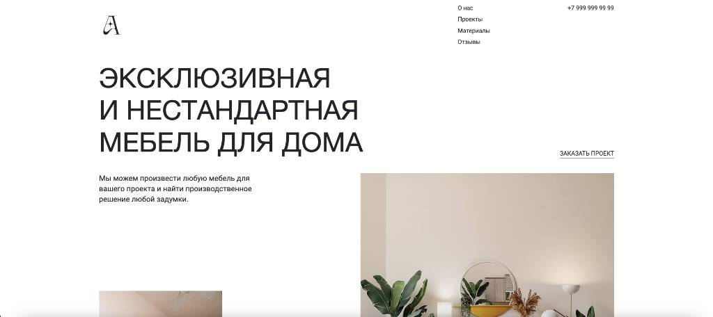

# Aveji — Производство мебели на заказ

Адаптивный лендинг для студии корпусной и дизайнерской мебели на заказ.

🔗 **[Посмотреть демо на GitHub Pages](https://tripdab.github.io/Aveji/)**

---

## 🛠 Стек технологий

- **HTML5** (семантическая верстка, доступность)
- **SCSS** (модульная структура, CSS Grid / Flexbox, адаптив `320px — 1920px+`)
- **БЭМ** (именование классов и организация стилей)
- **Vanilla JS** (нативные ES-модули без сборщиков и библиотек)

---

## ✨ Особенности реализации

- **Графика:** Поддержка форматов **AVIF** и **WebP** через тег `<picture>` с адаптацией под Retina-экраны (`1x`, `2x`).
- **Архитектура JS:** Секции «Проекты» и «Отзывы» вынесены в отдельные модули с динамическим рендерингом из массивов данных.
- **Интерактив:** Адаптивное бургер-меню с блокировкой скролла, закрытием по оверлею, якорным ссылкам и клавише `Escape`.
- **Качество и оптимизация:** Валидный код (W3C HTML5 / CSS3 — 0 ошибок) и высокие показатели производительности по Google Lighthouse (**98–100 баллов**).
